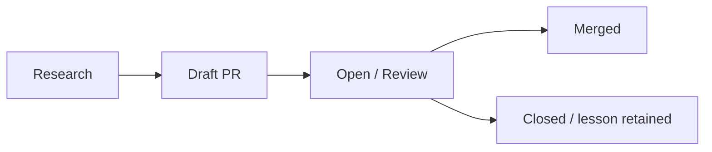

# CoreFoundry Contribution Ledger

A live public record of upstream open-source work tracked by CoreFoundry.

  **Merged PRs:** 15 | **Integrated separately:** 2 | **Open:** 25 | **Closed:** 7

> **Last synchronized:** 2026-11-02 20:39 UTC

## Record and attribution

CoreFoundry treats the **upstream pull request as the canonical public record**.

- upstream PR links are always primary;
- merged entries also retain the upstream merge-commit link when GitHub exposes one;
- contributor forks, local branches, staging repositories, and research harnesses are never required to reconstruct the public record;
- narrative metadata is curated, while PR state is synchronized automatically from GitHub.
- closed PRs integrated via another upstream commit are tracked separately, not counted as merged PRs.

## 🚀 Merged upstream work

| Project / PR | Engineering contribution | Evidence / impact |
|---|---|---|
| **[lballabio/QuantLib #2980](https://github.com/lballabio/QuantLib/pull/2980)** | Reused kernel evaluations in interpolation, reducing calls from 2N to N. | 1.70–1.94× faster across 5–40 nodes in reported benchmarks. |
| **[quickfix-j/quickfixj #1363](https://github.com/quickfix-j/quickfixj/pull/1363)** | Prevented failed synchronous writes from being reported as successful. | Regression-tested failed-write handling; merged upstream. |
| **[seanmonstar/reqwest #3116](https://github.com/seanmonstar/reqwest/pull/3116)** | Eliminated an unnecessary HTTP request-header map clone during dispatch. | 2–3% higher throughput on tested x86-64 workloads; up to 8.5% on ARM64. |
| **[Blosc/blogsite #18](https://github.com/Blosc/blogsite/pull/18)** | Published an illustrated technical analysis of avoiding parallel overhead in Blosc2. | Four original SVG figures; website build and figure-reference checks passed. |
| **[pandas-dev/pandas #69916](https://github.com/pandas-dev/pandas/pull/69916)** | The PR computes a function-local boolean, use_na_values = len(na_values) > 0, and guards the per-element __hash__ + membership check with it so empty… | ~17–25% faster in targeted maybe_convert_numeric benchmarks |
| **[python-attrs/attrs #1636](https://github.com/python-attrs/attrs/pull/1636)** [co-authored benchmark in python-attrs/attrs `0a08cee`](https://github.com/python-attrs/attrs/commit/0a08cee06960e415f735dec4cf2fb91d669e2433) | Skipped redundant attrs detection for sequences of known atomic types. | 1.76–3.33× faster in local CPython 3.14 list[int] benchmarks. |
| **[urllib3/urllib3 #5304](https://github.com/urllib3/urllib3/pull/5304)** | Removed redundant output copies in single-output gzip decompression. | 19–23% less client CPU in tested 32 MiB gzip HTTP responses. |
| **[pypa/packaging #1429](https://github.com/pypa/packaging/pull/1429)** | Avoided ast.literal_eval for plain quoted marker strings | ~13% faster on the representative Requirement corpus |
| **[bloomberg/memray #1035](https://github.com/bloomberg/memray/pull/1035)** | Reduced high-contention Tracker synchronization overhead on Linux/glibc | Up to 28% runtime reduction at 256 threads |
| **[Blosc/c-blosc2 #805](https://github.com/Blosc/c-blosc2/pull/805)** | Avoided unnecessary parallel startup and worker wakeups for small jobs | 35.86 μs → 2.02 μs on a targeted 64-byte workload |
| **[urllib3/urllib3 #5287](https://github.com/urllib3/urllib3/pull/5287)** | Optimized the common single-value header path | ~9–13% faster in representative request-construction workloads |
| **[Blosc/python-blosc2 #728](https://github.com/Blosc/python-blosc2/pull/728)** | Removed redundant full-block zeroing in a NumPy miniexpr gather path | ~2–15% improvement in tested workloads |
| **[numpy/numpy #32802](https://github.com/numpy/numpy/pull/32802)** | Fixed undefined shift behavior in the rational test dtype | Correctness fix |
| **[Blosc/python-blosc2 #713](https://github.com/Blosc/python-blosc2/pull/713)** | Fixed two NDArray thread-safety bugs blocking free-threaded Python support | Concurrency correctness / free-threading readiness |
| **[scipy/scipy #26225](https://github.com/scipy/scipy/pull/26225)** | Initialized bracketing-solver iteration counts on early-return paths | Correct zero-iteration solver statistics |

## 🔗 Integrated upstream via separate commit (original PR closed)

| Project / PR | Engineering contribution | Evidence / impact |
|---|---|---|
| **[bloomberg/bde #317](https://github.com/bloomberg/bde/pull/317)** [integrated in bloomberg/bde `76f43d2`](https://github.com/bloomberg/bde/commit/76f43d2b2b6b327095a24ff839277b1c655a1775) | The appendRaw and popLeaf helpers now preserve the path string's known length when calling hasLeaf, rather than passing c_str() and triggering a… | The PR reports median latency reductions of 14–65% for appendRaw and 38–73% for popLeaf across tested path lengths and root modes… |
| **[bloomberg/bde #315](https://github.com/bloomberg/bde/pull/315)** [integrated in bloomberg/bde `97e399a`](https://github.com/bloomberg/bde/commit/97e399a397287a6fadf63322983c5fb7a8b012e2) | The proposed change removes the AIX-specific CountedSemaphore selection and its macros. Darwin and generic POSIX policy selection remain unchanged.… | The author reports passing Linux and macOS policy, large-count (100,000), and 32-waiter contention checks. Full bslmt tests passed on… |

## 🟢 Open / in review

| Project / PR | Engineering contribution | Evidence / impact |
|---|---|---|
| **[aws/aws-lc #3700](https://github.com/aws/aws-lc/pull/3700)** | Uses shared C11 atomics on the common Linux fast path, retains the write lock for generation updates, and falls back to the original implementation… | The author reports 14.5% lower time per operation for RAND_bytes(32) with 4 threads and 94.9% lower time for the fork-generation check… |
| **[kokkos/kokkos #9725](https://github.com/kokkos/kokkos/pull/9725)** | Changes the limit check to use division instead of multiplication and adds a regression test. | The author says the calculation could overflow near `INT_MAX`, even when tile sizes were provided explicitly. They report testing with… |
| **[rack/rack #2549](https://github.com/rack/rack/pull/2549)** | Hash lookups now use the normalized request path, with a regression test added. Array mappings and index handling remain unchanged. | — |
| **[pmodels/mpich #8085](https://github.com/pmodels/mpich/pull/8085)** | Removes the disconnected client’s queued requests without affecting other waiters and adds a PMI2 fault test. Reviewer feedback also led to improved… | The PR description reports that the build and targeted PMI tests passed in GitHub Actions. The author confirmed updating test… |
| **[bloomberg/memray #1040](https://github.com/bloomberg/memray/pull/1040)** | The production change is limited to src/memray/_memray/record_writer.cpp, tests/integration/test_record_writer.py, and news/1039.feature.rst. It… | — |
| **[PX4/PX4-Autopilot #29537](https://github.com/PX4/PX4-Autopilot/pull/29537)** | The upload timestamp is now updated only after checking that the MISSION_COUNT sender matches the active upload, so rejected counts from another… | The PR reports that disarmed PX4 SITL testing on GitHub Actions reproduced the issue before the patch and verified timeout recovery… |
| **[bloomberg/blazingmq #1806](https://github.com/bloomberg/blazingmq/pull/1806)** | Separated key-building storage from final canonical-string storage | Most targeted PR2-vs-PR1 comparisons improved in final staged validation |
| **[bloomberg/blazingmq #1803](https://github.com/bloomberg/blazingmq/pull/1803)** | Removed temporary schema-key string construction | 120/120 controlled hot-path comparisons faster; median CPU ~61% lower in final validation |
| **[finos/FDC3 #2341](https://github.com/finos/FDC3/pull/2341)** | Clears the cached promise after failover rejection, so a later call can retry. Adds a regression test and updates CHANGELOG.md. | The PR reports a failure-then-success retry test and passing local build, TypeScript, Vitest, and ESLint checks. |
| **[scionproto/scion #5011](https://github.com/scionproto/scion/pull/5011)** | Replaces a temporary slice with a fixed-size stack buffer while retaining CRC64 hashing and path selection. | The author reports controlled encoder tests reduced allocations from 4 to 1 per packet and wall time by about 9–11% across tested… |
| **[opencv/opencv #30177](https://github.com/opencv/opencv/pull/30177)** | The BGRA path wraps the existing CVPixelBuffer pixels in a cv::Mat and retains the pixel buffer for frame lifetime. Existing BGR/RGB/GRAY/YUYV paths… | — |
| **[finos/ai-governance-framework #415](https://github.com/finos/ai-governance-framework/pull/415)** | Distinguishes a successful evaluation with no matching gating rule (baseline mi-18 authorization applies; mi-24 approval is not required) from a… | The PR describes a one-bullet change in mi-24, with no schema, runtime, or control-model changes. It reports that git diff --check… |
| **[dateutil/dateutil #1590](https://github.com/dateutil/dateutil/pull/1590)** | Used binary search for deep queries over already-ordered completed recurrence caches | ~4,500–5,700× faster on tested deep 200k-cache queries |
| **[nginx/nginx #1889](https://github.com/nginx/nginx/pull/1889)** | The PR adds an early return of NGX_HTTP_UPSTREAM_INVALID_HEADER when the configured buffer limit is exceeded, handing the response to existing… | The author reports that the official 4,691-test suite and additional boundary and retry tests passed. In the described stress test… |
| **[python-attrs/attrs #1646](https://github.com/python-attrs/attrs/pull/1646)** | The change skips unnecessary has() checks for dictionary keys and values. The author reports no behavior or public API changes. | The PR reports a 2.62× speedup for 1,000 atomic dictionary entries (164.8 µs to 62.9 µs), 48 passing differential tests, and 14/14… |
| **[apple/container #2292](https://github.com/apple/container/pull/2292)** | Prevented container stop from silently succeeding against an orphaned live runtime | End-to-end orphaned-runtime behavior validated on macOS |
| **[numpy/numpy #32787](https://github.com/numpy/numpy/pull/32787)** | Preserved BitGenerator state when reinitialization fails | Correctness / state-integrity fix |
| **[numpy/numpy #32895](https://github.com/numpy/numpy/pull/32895)** | The PR adds a locality-aware fast path to batched `searchsorted`, uses 16 sampled intermediate positions from the existing batched binary-search… | — |
| **[serde-rs/json #1356](https://github.com/serde-rs/json/pull/1356)** | The author tried parsing by accumulating the value directly with checked arithmetic, aiming to preserve existing parsing behavior, overflow handling… | The author reports isolated benchmarks showing ~1.5–2× faster parsing for longer 128-bit integers, zero temporary allocations versus… |
| **[python-cffi/cffi #282](https://github.com/python-cffi/cffi/pull/282)** | Specialized fixed-signature cdata calls while preserving the generic fallback | ~25–30% faster for targeted scalar signatures |
| **[python-hyper/h11 #207](https://github.com/python-hyper/h11/pull/207)** | Removed redundant normalization and intermediate representation work in parsed wire headers | ~3.3–11.7% faster across targeted parsing workloads |
| **[bloomberg/bde #319](https://github.com/bloomberg/bde/pull/319)** | The PR adds a fast path for the case where a thread repeatedly resolves the global default logger and has never set a custom logger. It remembers… | The PR body says: 'remember a negative lookup for the current thread, reuse it while valid' and 'The cache remembers only that this… |
| **[scientific-python/blog.scientific-python.org #277](https://github.com/scientific-python/blog.scientific-python.org/pull/277)** | The PR adds article content that focuses on reusing information from prior searches, deciding when locality is useful, the 8 / 16 / 32 observation… | — |
| **[scipy/scipy #26226](https://github.com/scipy/scipy/pull/26226)** | Handled single-coefficient cspline1d_eval/qspline1d_eval without recursive failure | Correctness fix; targeted tests passed |
| **[apple/container #2293](https://github.com/apple/container/pull/2293)** | Reconciled persisted container state with still-running runtimes after apiserver restart | End-to-end state recovery and stop/kill behavior validated on macOS |

## 🟡 Draft / validating

_No tracked entries in this state._

## ⚪ Closed / lessons retained

| Project / PR | Engineering contribution | Evidence / impact |
|---|---|---|
| **[nasa/fprime #6294](https://github.com/nasa/fprime/pull/6294)** | The PR proposed reporting FW_STATUS_FAILED_TO_WRITE if either write fails, correcting the reported byte count, and handling zero-length writes… | The author describes the failure case, proposed behavior, rationale, and regression tests in the PR body. An automated comment says… |
| **[nasa/fprime #6292](https://github.com/nasa/fprime/pull/6292)** | The proposed change tracks queue occupancy across priorities, updates the high-water mark on enqueue and dequeue, and checks that configured total… | The author reported 7/7 Framework CI jobs and 7/7 Reference CI jobs passed, including TSan and Linux/macOS integration tests, while… |
| **[kjd/idna #279](https://github.com/kjd/idna/pull/279)** [related maintainer-authored fast path in kjd/idna `6058844`](https://github.com/kjd/idna/commit/605884450001cb08c71ab04433c2581f25ca347c) | The PR adds a fast path in alabel() for non-ACE ASCII labels containing only letters, digits, and hyphens, with length and hyphen checks. Other… | The author reports 79.5–85.1% lower execution time on two ordinary ASCII encode workloads and no behavioral mismatches in differential… |
| **[numpy/numpy #32869](https://github.com/numpy/numpy/pull/32869)** | Added a locality-aware fast path to typed searchsorted | ~5.3–5.8× faster on tested strong-locality workloads |
| **[pypa/packaging #1431](https://github.com/pypa/packaging/pull/1431)** | Hardened the marker fast-path invariants | ~9.5% faster than baseline while retaining stronger defensive checks |
| **[bloomberg/bde #313](https://github.com/bloomberg/bde/pull/313)** | Opened by mistake | — |
| **[pandas-dev/pandas #69776](https://github.com/pandas-dev/pandas/pull/69776)** | Investigated preservation of the distinction between pd.NA and IEEE NaN across parser paths | Closed / unmerged |

---

## How this page is maintained

This file is generated by `.github/workflows/sync-contributions.yml` from:

1. public upstream PR state from GitHub;
2. curated display metadata in `data/contribution_metadata.json`.
3. separately integrated upstream commit evidence.

New public upstream PRs authored by the tracked contributor are discovered automatically. Closed-but-unmerged work is included only when explicitly retained in metadata.

> Do not edit this file by hand; changes will be overwritten by the next synchronization run.
