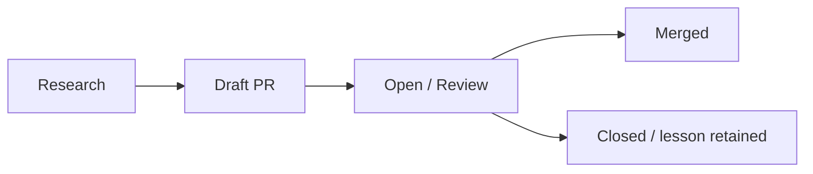

# CoreFoundry Contribution Ledger

A live public record of upstream open-source work tracked by CoreFoundry.

  **Merged PRs:** 14 | **Integrated separately:** 2 | **Open:** 25 | **Closed:** 5

> **Last synchronized:** 2026-10-31 05:54 UTC

## Canonical-source policy

CoreFoundry treats the **upstream pull request as the canonical public record**.

- upstream PR links are always primary;
- merged entries also retain the upstream merge-commit link when GitHub exposes one;
- contributor forks, local branches, staging repositories, and research harnesses are never required to reconstruct the public record;
- narrative metadata is curated, while PR state is synchronized automatically from GitHub.
- closed PRs integrated via another upstream commit are tracked separately, not counted as merged PRs.

## 🚀 Merged upstream work

| Project / PR | What it is | What changed | Evidence / impact | Why this matters |
|---|---|---|---:|---|
| **[quickfix-j/quickfixj #1363](https://github.com/quickfix-j/quickfixj/pull/1363)** [merge commit `b25838e`](https://github.com/quickfix-j/quickfixj/commit/b25838e4245b332951cc13f32b6cf3b00d4ac9ed) | A QuickFIX/J pull request addressing synchronous writes reported as successful when the underlying MINA write fails. | The PR checks `WriteFuture.isWritten()` before returning `true` from synchronous writes. Its description says asynchronous behavior and timeout handling remain unchanged, and regression coverage was added for a completed but failed write. | Targeted regression test checks a completed-but-failed write. The author reports 9/9 successful fork Maven CI jobs on Ubuntu, Windows and macOS 15 with Java 8/11/21. Reviewed and approved by the-thing; merged by chrjohn on 2026-10-29 UTC. No production incident rate, remote-peer receipt proof or performance gain measured. ([source](https://github.com/quickfix-j/quickfixj/pull/1363)) | It prevents a completed but failed synchronous write from being reported as successful. |
| **[seanmonstar/reqwest #3116](https://github.com/seanmonstar/reqwest/pull/3116)** [merge commit `8e1c806`](https://github.com/seanmonstar/reqwest/commit/8e1c8061e5dd936762dcef08a64ef2cff584b295) | A reqwest pull request proposing to avoid cloning request headers during dispatch. | The author moves the HeaderMap into the outgoing request and removes its unused copy from PendingRequest. The PR reports workload-dependent throughput improvements in local HTTP/1.1 benchmarks and says the change adds no dependencies. | The author reports workload-dependent throughput gains in local HTTP/1.1 tests, including +2.0–3.0% for 16 sequential headers on Linux x86-64 and +8.5% on Linux ARM64. The author also reports that 39/39 jobs passed on their fork. ([source](https://github.com/seanmonstar/reqwest/pull/3116)) | The change aims to avoid an unnecessary header-map clone; the reported benchmark results vary by architecture and workload. |
| **[Blosc/blogsite #18](https://github.com/Blosc/blogsite/pull/18)** [merge commit `01cba31`](https://github.com/Blosc/blogsite/commit/01cba31da6536807fc4b799739d3d42d8065f0f4) | A proposed Blosc blog article about the ideas behind C-Blosc2 PR #805. | The contribution adds a Markdown article with Nikola metadata and four original SVG figures. The author says it uses analogies, benchmarks, visualizations, and discussion of alternative approaches and trade-offs. After review, the author revised the flow and style, simplified the benchmark section, and added a link to the rainfall sample dataset. | The author states the article explores the idea that avoiding unnecessary work can be the best way to improve performance, and says the post includes benchmark results and visualizations. The PR body also notes that the Nikola website build and figure-reference checks passed in a GitHub Actions run, and that the article is intended to fit the Blosc blog with possible editorial adjustments. ([source](https://github.com/Blosc/blogsite/pull/18)) | The article aims to explain how avoiding unnecessary work can improve performance, while clarifying that the benefit depends on the workload. |
| **[pandas-dev/pandas #69916](https://github.com/pandas-dev/pandas/pull/69916)** [merge commit `93ed047`](https://github.com/pandas-dev/pandas/commit/93ed0471db24c55359a9312c6b3dc6eecb6fa097) | A pandas performance optimization for maybe_convert_numeric that short-circuits the empty-na_values case while preserving the existing behavior for non-empty na_values; reviewer discussion also characterizes the change as a bugfix for an unhashable nested-tuple object case in to_numeric. | The PR computes a function-local boolean, use_na_values = len(na_values) > 0, and guards the per-element __hash__ + membership check with it so empty sets skip Python-level membership work. The author then adds the required regression test and whatsnew entry after review identified the unhashable nested-tuple case as an improvement and bugfix candidate. | ~17–25% faster in targeted maybe_convert_numeric benchmarks ([source](https://github.com/pandas-dev/pandas/pull/69916)) | It removes unnecessary per-element Python object work when na_values is empty, which improves the direct numeric-conversion hot path without changing the conversion rules for non-empty na_values. It also addresses a concrete edge case in object-dtype coercion that review flagged as a bugfix-worthy behavior change. |
| **[python-attrs/attrs #1636](https://github.com/python-attrs/attrs/pull/1636)** [merge commit `8f76a52`](https://github.com/python-attrs/attrs/commit/8f76a5262b3b426bfb6a1127f12d49430d168c8b) [co-authored benchmark in python-attrs/attrs `0a08cee`](https://github.com/python-attrs/attrs/commit/0a08cee06960e415f735dec4cf2fb91d669e2433) | A performance improvement for `attrs.astuple()` when traversing nested sequences containing atomic values. | Sequence elements with exact types already known to be atomic now skip attrs detection via `has()`. Non-atomic values retain the existing fallback. | The PR reports a local CPython 3.14 `list[int]` benchmark speedup of 1.76× for 10 elements, 2.95× for 100, and 3.33× for 1,000. It also reports 1,407 tests passed, 4 skipped, and 2 xfailed, and includes a CodSpeed benchmark for nested atomic sequences. ([source](https://github.com/python-attrs/attrs/pull/1636)) | Avoiding attrs detection for atomic sequence elements reduces unnecessary work during `astuple()` traversal; the PR reports larger benchmark speedups as the list size increases. |
| **[urllib3/urllib3 #5304](https://github.com/urllib3/urllib3/pull/5304)** [merge commit `5ebe9bf`](https://github.com/urllib3/urllib3/commit/5ebe9bf9f691646dcabdb259ffabfc6108ded5e8) | Core HTTP and content-decoding infrastructure used throughout Python | Avoided an unnecessary bytes → bytearray → bytes copy for single-output gzip decompression | 8 paired A/B rounds across 15 controlled HTTP scenarios: ~19–23% lower client CPU time for tested 32 MiB gzip responses; decoder-only tests: ~26–27 μs saved/MiB | Eliminating a redundant output copy cuts decompression and HTTP client CPU costs without changing public APIs; workload-specific results, not production-average savings |
| **[pypa/packaging #1429](https://github.com/pypa/packaging/pull/1429)** [merge commit `d17cfaf`](https://github.com/pypa/packaging/commit/d17cfaf0b77a5690f03087359e7c8d665a3c728d) | Foundational Python packaging and requirement-parsing infrastructure | Avoided ast.literal_eval for plain quoted marker strings | ~13% faster on the representative Requirement corpus | Common marker values should not pay for a general-purpose literal parser |
| **[bloomberg/memray #1035](https://github.com/bloomberg/memray/pull/1035)** [merge commit `d0c34e8`](https://github.com/bloomberg/memray/commit/d0c34e8d6c341bf5e415220203e0a2563c9d65ff) | Python memory profiling and allocation-analysis infrastructure | Reduced high-contention Tracker synchronization overhead on Linux/glibc | Up to 28% runtime reduction at 256 threads | Profiling infrastructure should observe workloads without becoming a major bottleneck |
| **[Blosc/c-blosc2 #805](https://github.com/Blosc/c-blosc2/pull/805)** [merge commit `89dffce`](https://github.com/Blosc/c-blosc2/commit/89dffce3066e5b40e41ca506efb61596f863bc9a) | High-performance compression infrastructure | Avoided unnecessary parallel startup and worker wakeups for small jobs | 35.86 μs → 2.02 μs on a targeted 64-byte workload | Small workloads should not pay parallel execution costs they cannot amortize |
| **[urllib3/urllib3 #5287](https://github.com/urllib3/urllib3/pull/5287)** [merge commit `796d200`](https://github.com/urllib3/urllib3/commit/796d200d3070ead69ec3a5d848fecf52a2249b59) | Core HTTP infrastructure used throughout Python | Optimized the common single-value header path | ~9–13% faster in representative request-construction workloads | Foundational HTTP improvements can propagate across a large number of Python applications |
| **[Blosc/python-blosc2 #728](https://github.com/Blosc/python-blosc2/pull/728)** [merge commit `3ce2a39`](https://github.com/Blosc/python-blosc2/commit/3ce2a390a244ab2c6563d25da7f5b15e6583d24b) | Python interface to high-performance compressed-data infrastructure | Removed redundant full-block zeroing in a NumPy miniexpr gather path | ~2–15% improvement in tested workloads | Avoiding unnecessary memory work improves throughput without adding compute |
| **[numpy/numpy #32802](https://github.com/numpy/numpy/pull/32802)** [merge commit `24f3c80`](https://github.com/numpy/numpy/commit/24f3c807bd4397315028fce096ff939e577c13ed) | Foundational numerical-computing library | Fixed undefined shift behavior in the rational test dtype | Correctness fix | Low-level correctness bugs can affect a very large downstream dependency graph |
| **[Blosc/python-blosc2 #713](https://github.com/Blosc/python-blosc2/pull/713)** [merge commit `bf8ae3c`](https://github.com/Blosc/python-blosc2/commit/bf8ae3c57f06700b8e664df3534bf0990ab5f7ee) | Compressed-array and data infrastructure | Fixed two NDArray thread-safety bugs blocking free-threaded Python support | Concurrency correctness / free-threading readiness | Infrastructure must remain correct as Python moves toward broader free-threaded execution |
| **[scipy/scipy #26225](https://github.com/scipy/scipy/pull/26225)** [merge commit `35cf9df`](https://github.com/scipy/scipy/commit/35cf9df1a24bd2e97598edaf56e0545b992508ba) | Scientific-computing algorithms and numerical methods | Initialized bracketing-solver iteration counts on early-return paths | Correct zero-iteration solver statistics | Reliable solver accounting improves correctness and observability |

## 🔗 Integrated upstream via separate commit (original PR closed)

| Project / PR | What it is | What changed | Evidence / impact | Why this matters |
|---|---|---|---:|---|
| **[bloomberg/bde #317](https://github.com/bloomberg/bde/pull/317)** [integrated in bloomberg/bde `76f43d2`](https://github.com/bloomberg/bde/commit/76f43d2b2b6b327095a24ff839277b1c655a1775) | A small optimization to BDE's bdls_pathutil mutable path helpers. | The appendRaw and popLeaf helpers now preserve the path string's known length when calling hasLeaf, rather than passing c_str() and triggering a length rescan. The PR reports no public API or ABI change. Review discussion suggested simplifying the calls by passing the string directly; the author confirmed the length-aware conversion and revised accordingly. | The PR reports median latency reductions of 14–65% for appendRaw and 38–73% for popLeaf across tested path lengths and root modes; these are microbenchmark results, not end-to-end application speedups. It also reports Ubuntu bdls package tests (15/15) and a Windows regression passing. A reviewer asked about passing the string directly, and the author confirmed revising the calls as suggested. A comment says the change was merged via an internal repository. ([source](https://github.com/bloomberg/bde/pull/317)) | Avoiding a redundant path-length scan reduces work in both helpers, with larger reported gains on longer paths. The change also aligns these calls with length-aware parsing and avoids the prior embedded-NUL inconsistency described in the PR. |
| **[bloomberg/bde #315](https://github.com/bloomberg/bde/pull/315)** [integrated in bloomberg/bde `97e399a`](https://github.com/bloomberg/bde/commit/97e399a397287a6fadf63322983c5fb7a8b012e2) | A pull request to remove the obsolete AIX semaphore-policy branch from BDE’s bslmt_platform.h. | The proposed change removes the AIX-specific CountedSemaphore selection and its macros. Darwin and generic POSIX policy selection remain unchanged. The PR reports no behavior change for current supported/generated configurations; manually forcing the removed AIX macro changes policy selection. | The author reports passing Linux and macOS policy, large-count (100,000), and 32-waiter contention checks. Full bslmt tests passed on Linux; macOS full-package failures were reproduced on the unmodified baseline. A comment says the PR will be merged via an internal repository; the supplied sources do not confirm that merge. ([source](https://github.com/bloomberg/bde/pull/315)) | The cleanup aligns semaphore policy selection with the removal of AIX detection from bsls_platform and reduces obsolete compatibility logic. The author describes the benefit as maintenance-oriented, not a runtime performance improvement. |

## 🟢 Open / in review

| Project / PR | What it is | What changed | Evidence / impact | Why this matters |
|---|---|---|---:|---|
| **[PX4/PX4-Autopilot #29537](https://github.com/PX4/PX4-Autopilot/pull/29537)** | A PX4-Autopilot fix for mission-upload timeout handling. | The upload timestamp is now updated only after checking that the MISSION_COUNT sender matches the active upload, so rejected counts from another sender do not refresh its timeout. | The PR reports that disarmed PX4 SITL testing on GitHub Actions reproduced the issue before the patch and verified timeout recovery and a new upload afterward. ([source](https://github.com/PX4/PX4-Autopilot/pull/29537)) | A different sender repeatedly transmitting mission counts could otherwise keep a stalled upload alive beyond the 5-second timeout and block new uploads. |
| **[lballabio/QuantLib #2980](https://github.com/lballabio/QuantLib/pull/2980)** | A change to avoid duplicate kernel evaluations in QuantLib's KernelInterpolation. | KernelInterpolation::value() reuses each kernel value for both the weighted sum and normalization, reducing evaluations from 2N to N without changing the public API or interpolation formula. | The PR reports that staging builds and interpolation tests passed on Linux, macOS, and Windows, and that the full QuantLib test suite passed on Linux. It also reports benchmark speedups of 1.70x (5 nodes), 1.83x (10), 1.91x (20), and 1.94x (40), using 100,000 evaluations per run and the five-run median. ([source](https://github.com/lballabio/QuantLib/pull/2980)) | Reusing kernel values avoids repeated calculations while preserving the existing interpolation behavior and API. |
| **[nasa/fprime #6292](https://github.com/nasa/fprime/pull/6292)** | A pull request proposing a fix for aggregate high-water mark tracking in F Prime's PriorityMemQueue. | The change tracks shared queue occupancy across priorities, updates the high-water mark on enqueue and dequeue, checks that total configured capacity fits in U32, and adds regression tests for multiple priorities and concurrent producers. | The author says the existing behavior could report 4 messages when two priorities hold 3 and 4, rather than the aggregate 7. The author reports 7/7 jobs passed in both Framework CI and Reference CI, including TSan and Linux/macOS integration tests, while noting that passing tests do not establish exhaustive concurrency correctness. ([source](https://github.com/nasa/fprime/pull/6292)) | The author says underreporting makes the high-water mark less useful for capacity monitoring; per-priority sampling can also be unreliable when sends and receives overlap. |
| **[nasa/fprime #6294](https://github.com/nasa/fprime/pull/6294)** | fprime | Svc/FileWorker: Report checksum sidecar write failures | — | — |
| **[bloomberg/blazingmq #1806](https://github.com/bloomberg/blazingmq/pull/1806)** | Enterprise messaging infrastructure | Separated key-building storage from final canonical-string storage | Most targeted PR2-vs-PR1 comparisons improved in final staged validation | Allocator growth history can create hidden performance cliffs even after obvious temporary allocations are removed |
| **[bloomberg/blazingmq #1803](https://github.com/bloomberg/blazingmq/pull/1803)** | Enterprise messaging infrastructure | Removed temporary schema-key string construction | 120/120 controlled hot-path comparisons faster; median CPU ~61% lower in final validation | Temporary allocation on a repeated schema path can dominate otherwise small work |
| **[finos/FDC3 #2341](https://github.com/finos/FDC3/pull/2341)** | A fix for retrying getAgent() after a failover function rejects. | Clears the cached promise after failover rejection, so a later call can retry. Adds a regression test and updates CHANGELOG.md. | The PR reports a failure-then-success retry test and passing local build, TypeScript, Vitest, and ESLint checks. ([source](https://github.com/finos/FDC3/pull/2341)) | A rejected failover no longer leaves subsequent getAgent() calls blocked by the cached rejected promise. |
| **[scionproto/scion #5011](https://github.com/scionproto/scion/pull/5011)** | A proposed SCION Gateway optimization to packet five-tuple hashing. | Replaces a temporary slice with a fixed-size stack buffer while retaining CRC64 hashing and path selection. | The author reports controlled encoder tests reduced allocations from 4 to 1 per packet and wall time by about 9–11% across tested workloads. IPv4/IPv6 regression tests, Linux Gateway tests, the race detector, and Go vet passed. The benchmarks cover SIG frame encoding, not end-to-end network throughput. ([source](https://github.com/scionproto/scion/pull/5011)) | The change targets avoidable heap allocations in the multi-path packet-processing path without changing packet behavior or wire format. |
| **[opencv/opencv #30177](https://github.com/opencv/opencv/pull/30177)** | A pull request proposing opt-in zero-copy BGRA retrieval for OpenCV’s macOS AVFoundation video capture path. | The BGRA path wraps the existing CVPixelBuffer pixels in a cv::Mat and retains the pixel buffer for frame lifetime. Existing BGR/RGB/GRAY/YUYV paths remain unchanged; UMat still copies. After review identified that BGRA retrieval consumed the grabbed frame and broke repeated retrieve() calls, the author updated the implementation to preserve the frame until the next grab and added a regression test. | — ([source](https://github.com/opencv/opencv/pull/30177)) | Callers that can accept BGRA may avoid the color conversion and extra frame work inside retrieve(). The PR also notes a memory trade-off: retaining pixel buffers while callers keep frames alive can increase memory use. |
| **[finos/ai-governance-framework #415](https://github.com/finos/ai-governance-framework/pull/415)** | A documentation-only pull request clarifying fail-closed behavior for ungated actions in mi-24. | Distinguishes a successful evaluation with no matching gating rule (baseline mi-18 authorization applies; mi-24 approval is not required) from a matching rule without valid approval (block execution) and from failures in policy evaluation, action resolution, or approval-state determination (fail closed). | The PR describes a one-bullet change in mi-24, with no schema, runtime, or control-model changes. It reports that git diff --check passed. ([source](https://github.com/finos/ai-governance-framework/pull/415)) | Clarifies that a confirmed non-gated action is different from a failed or indeterminate gating-policy evaluation. |
| **[aws/aws-lc #3700](https://github.com/aws/aws-lc/pull/3700)** | A pull request proposing a faster Linux fork-generation check in AWS-LC. | Uses shared C11 atomics on the common Linux fast path, retains the write lock for generation updates, and falls back to the original implementation where the required atomics are not lock-free. The PR says it does not change public APIs, the DRBG, entropy sources, or the underlying fork-detection mechanism. | The author reports 14.5% lower time per operation for RAND_bytes(32) with 4 threads and 94.9% lower time for the fork-generation check with 4 threads, based on the median of seven paired runs on a 4-vCPU Linux runner. AWS-LC Minimal and Go tests, concurrent generation checks, and ThreadSanitizer tests passed in the validated scenarios. The author notes that an uncoordinated multithreaded fork stress test stalled intermittently in both builds and was not counted as passing evidence; testing does not prove every fork/VM-clone interleaving. ([source](https://github.com/aws/aws-lc/pull/3700)) | The proposed change aims to reduce synchronization overhead on a frequently used fork-generation check, including during concurrent RAND_bytes calls. |
| **[dateutil/dateutil #1590](https://github.com/dateutil/dateutil/pull/1590)** | Date/time, recurrence, and timezone infrastructure | Used binary search for deep queries over already-ordered completed recurrence caches | ~4,500–5,700× faster on tested deep 200k-cache queries | An existing ordering invariant can collapse repeated linear scans into logarithmic lookup |
| **[nginx/nginx #1889](https://github.com/nginx/nginx/pull/1889)** | A proposed NGINX change addressing excessive memory allocation when an upstream sends too many HTTP 103 Early Hints responses. | The PR adds an early return of NGX_HTTP_UPSTREAM_INVALID_HEADER when the configured buffer limit is exceeded, handing the response to existing upstream error handling and retry logic. | The author reports that the official 4,691-test suite and additional boundary and retry tests passed. In the described stress test, the original version showed 183,208 KiB of RSS growth; the patched version showed 44 KiB and stopped after 81 hints. The author notes this is an observed test result, not a universal memory bound. ([source](https://github.com/nginx/nginx/pull/1889)) | The proposed change aims to stop processing oversized Early Hints responses early, avoiding the continued request-pool allocations described in the PR and improving resilience to unexpected upstream behavior. |
| **[python-attrs/attrs #1646](https://github.com/python-attrs/attrs/pull/1646)** | A pull request proposing a performance improvement to attrs' astuple() when processing dictionaries. | The change skips unnecessary has() checks for dictionary keys and values. The author reports no behavior or public API changes. | The PR reports a 2.62× speedup for 1,000 atomic dictionary entries (164.8 µs to 62.9 µs), 48 passing differential tests, and 14/14 upstream native CI jobs passing on a staging fork. ([source](https://github.com/python-attrs/attrs/pull/1646)) | The reported benchmarks indicate faster astuple() processing for dictionaries, especially when their keys and values are atomic. |
| **[apple/container #2292](https://github.com/apple/container/pull/2292)** | Apple container runtime infrastructure | Prevented container stop from silently succeeding against an orphaned live runtime | End-to-end orphaned-runtime behavior validated on macOS | Control-plane state should not report success when the underlying runtime remains alive |
| **[numpy/numpy #32787](https://github.com/numpy/numpy/pull/32787)** | Foundational numerical-computing and random-number infrastructure | Preserved BitGenerator state when reinitialization fails | Correctness / state-integrity fix | Failed initialization should not leave foundational random-number state partially mutated |
| **[numpy/numpy #32895](https://github.com/numpy/numpy/pull/32895)** | A proposed NumPy optimization for batched `searchsorted` that reuses prior insertion-position information when consecutive query keys have strong locality, with a selector and a conservative activation threshold to avoid paying the added logic cost on less favorable workloads. | The PR adds a locality-aware fast path to batched `searchsorted`, uses 16 sampled intermediate positions from the existing batched binary-search computation to detect helpful locality, and adds a `Q >= 2^20` gate so the optimization is only used when the author judged the benefit large enough to justify the extra overhead. The author later refined the selector to reject adversarial patterns by comparing each sampled point with the value immediately before it, and added tests covering large-query cases, duplicate keys, NaN/NaT/complex NaN, disordered inputs, and focused ASV checks. | — ([source](https://github.com/numpy/numpy/pull/32895)) | The work is relevant because it targets a real performance opportunity in NumPy's batched `searchsorted` path, but it also treats the problem as a hybrid algorithm with selector risk, machine-specific cost, and maintenance burden. The discussion shows the central tradeoff: a fast path can help strongly local workloads, but maintainers are concerned about degradation risk, the cost of complexity, and the need for broad benchmark and adversarial-case validation before accepting such a path. |
| **[serde-rs/json #1356](https://github.com/serde-rs/json/pull/1356)** | A proposed serde_json change to avoid allocating a temporary String when deserializing i128 and u128 values. | The author tried parsing by accumulating the value directly with checked arithmetic, aiming to preserve existing parsing behavior, overflow handling, and error positions. The PR notes that it keeps the current negative-zero behavior, which could interact with #1353. | The author reports isolated benchmarks showing ~1.5–2× faster parsing for longer 128-bit integers, zero temporary allocations versus 1–4 previously, and passing existing tests, feature checks, and added regression tests. ([source](https://github.com/serde-rs/json/pull/1356)) | If validated and accepted, the approach could reduce temporary allocations and improve parsing speed for longer 128-bit integers. |
| **[python-cffi/cffi #282](https://github.com/python-cffi/cffi/pull/282)** | Python ↔ C foreign-function interface infrastructure | Specialized fixed-signature cdata calls while preserving the generic fallback | ~25–30% faster for targeted scalar signatures | Native-boundary overhead can be reduced without replacing the mature general path |
| **[python-hyper/h11 #207](https://github.com/python-hyper/h11/pull/207)** | Pure-Python HTTP/1.1 protocol infrastructure | Removed redundant normalization and intermediate representation work in parsed wire headers | ~3.3–11.7% faster across targeted parsing workloads | Protocol parsing can remove duplicate work while preserving exact validation order |
| **[bloomberg/bde #319](https://github.com/bloomberg/bde/pull/319)** | A proposed optimization for BDE LoggerManager default-logger lookups: it caches a thread-local negative result ('this thread has no custom logger') so repeated lookups can skip lock-and-map work while preserving the existing fallback path. | The PR adds a fast path for the case where a thread repeatedly resolves the global default logger and has never set a custom logger. It remembers only the negative condition for the current thread, invalidates it when the thread changes logger or when a manager is recreated, and leaves the public class layout and existing behavior outside that path unchanged. | The PR body says: 'remember a negative lookup for the current thread, reuse it while valid' and 'The cache remembers only that this thread has no custom logger. It never caches a custom Logger*.' It also reports that in the instrumented mixed workload, '55.6% of calls ... used the new fast path' and that paired CPU time was '53–56% lower' on three Ubuntu runners; it explicitly notes these are component-level results and not end-to-end logging performance. ([source](https://github.com/bloomberg/bde/pull/319)) | It targets repeated low-level logger lookup overhead in mixed custom/default workloads without redesigning logger ownership or changing the public API. The author presents it as a focused review proposal rather than a universal optimization, with trade-offs around cache invalidation and extra TLS/atomic state. |
| **[scientific-python/blog.scientific-python.org #277](https://github.com/scientific-python/blog.scientific-python.org/pull/277)** | A proposed Scientific Python blog article titled "BLOG: Finding Another Layer of Performance in np.searchsorted," describing a performance investigation around reusing insertion-position locality in NumPy search behavior. | The PR adds article content that focuses on reusing information from prior searches, deciding when locality is useful, the 8 / 16 / 32 observation experiments, hardware-dependent activation behavior, and how reducing search work complements earlier batched-search optimization. The body also says the NumPy implementation of the experiment is under separate review and that the article centers on the performance idea, experimental process, and broader optimization insight. | — ([source](https://github.com/scientific-python/blog.scientific-python.org/pull/277)) | It documents a performance-analysis idea in NumPy search optimization and signals that the blog should align with a separate upstream implementation review to reflect current changes. |
| **[bloomberg/memray #1040](https://github.com/bloomberg/memray/pull/1040)** | A Memray pull request that optimizes allocation-record serialization by encoding one logical record into a fixed 32-byte stack buffer and writing it once through Sink::writeAll(), while preserving the existing wire format and behavior. | The production change is limited to src/memray/_memray/record_writer.cpp, tests/integration/test_record_writer.py, and news/1039.feature.rst. It removes repeated sink-entry overhead for one logical allocation record, keeps the same wire format, and adds validation for 32-bit/64-bit encoding, semantic equivalence, contention, and failed-I/O byte-boundary cases. | — ([source](https://github.com/bloomberg/memray/pull/1040)) | It reduces repeated abstraction overhead in a hot allocation-record path without introducing heap allocation, new caches, synchronization, syscalls, or persistent state. The PR also documents the 32-byte bound and notes that future wire-format growth would require updating that bound and boundary tests together. |
| **[scipy/scipy #26226](https://github.com/scipy/scipy/pull/26226)** | Scientific-computing algorithms and signal-processing infrastructure | Handled single-coefficient cspline1d_eval/qspline1d_eval without recursive failure | Correctness fix; targeted tests passed | Small edge cases in foundational numerical routines should fail predictably rather than recurse indefinitely |
| **[apple/container #2293](https://github.com/apple/container/pull/2293)** | Apple container runtime infrastructure | Reconciled persisted container state with still-running runtimes after apiserver restart | End-to-end state recovery and stop/kill behavior validated on macOS | Crash recovery requires reconstructing authoritative runtime state instead of trusting stale in-memory state |

## 🟡 Draft / validating

_No tracked entries in this state._

## ⚪ Closed / lessons retained

| Project / PR | What it is | What changed | Evidence / impact | Why this matters |
|---|---|---|---:|---|
| **[kjd/idna #279](https://github.com/kjd/idna/pull/279)** [related maintainer-authored fast path in kjd/idna `6058844`](https://github.com/kjd/idna/commit/605884450001cb08c71ab04433c2581f25ca347c) | A proposal to speed up ordinary ASCII domain-label encoding in kjd/idna. | The PR adds a fast path in alabel() for non-ACE ASCII labels containing only letters, digits, and hyphens, with length and hyphen checks. Other labels continue through the existing validation path. | The author reports 79.5–85.1% lower execution time on two ordinary ASCII encode workloads and no behavioral mismatches in differential testing. The maintainer said they would not accept this PR as-is, describing it as overly complicated, and implemented the underlying concept in #287. ([source](https://github.com/kjd/idna/pull/279)) | The proposal aims to avoid unnecessary Unicode validation for ordinary ASCII labels while preserving the existing path for ACE, Unicode, and other inputs. The maintainer's response indicates the concept was carried forward in a separate implementation. |
| **[numpy/numpy #32869](https://github.com/numpy/numpy/pull/32869)** | Foundational numerical-computing infrastructure | Added a locality-aware fast path to typed searchsorted | ~5.3–5.8× faster on tested strong-locality workloads | Reusing already-computed coarse state can remove search work without adding another O(Q) pass |
| **[pypa/packaging #1431](https://github.com/pypa/packaging/pull/1431)** | Foundational Python packaging and requirement-parsing infrastructure | Hardened the marker fast-path invariants | ~9.5% faster than baseline while retaining stronger defensive checks | Performance fast paths need explicit boundaries that survive future parser changes |
| **[bloomberg/bde #313](https://github.com/bloomberg/bde/pull/313)** | bde | Opened by mistake | — | — |
| **[pandas-dev/pandas #69776](https://github.com/pandas-dev/pandas/pull/69776)** | Core data-processing and CSV parsing infrastructure | Investigated preservation of the distinction between pd.NA and IEEE NaN across parser paths | Closed / unmerged | The work exposed where information can be lost across parser and Arrow conversion boundaries |

---

## How this page is maintained

This file is generated by `.github/workflows/sync-contributions.yml` from:

1. public upstream PR state from GitHub;
2. curated display metadata in `data/contribution_metadata.json`.
3. separately integrated upstream commit evidence.

New public upstream PRs authored by the tracked contributor are discovered automatically. Closed-but-unmerged work is included only when explicitly retained in metadata.

> Do not edit this file by hand; changes will be overwritten by the next synchronization run.
