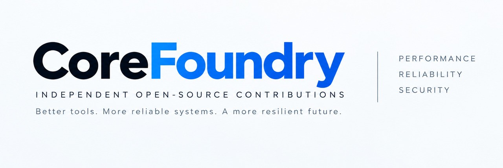

# CoreFoundry

**Independent research and engineering for open-source infrastructure.**

I investigate performance bottlenecks, correctness bugs, and security issues—and turn validated findings into upstream contributions. The goal is straightforward: improve software that other systems depend on.

## 🔬 Research & Upstream Engineering

**⚡ Performance · 🛠️ Correctness · 🔐 Security**

| Research Area | Selected Projects | Upstream Evidence |
|---|---|---|
| 🌐 Networking & Web | [curl](https://github.com/curl/curl/commit/12ab9f50d7c358b44188fe972cc15ba068901de9), [urllib3](https://github.com/urllib3/urllib3/pull/5304), [NGINX](https://github.com/nginx/nginx/pull/1889), [Rack](https://github.com/rack/rack/pull/2549), [reqwest](https://github.com/seanmonstar/reqwest/pull/3116)| [**urllib3: 19–23% less CPU**](https://github.com/urllib3/urllib3/pull/5304) |
| 🔐 Security & Cryptography | [AWS-LC](https://github.com/aws/aws-lc/pull/3700), [curl](https://github.com/curl/curl/commit/12ab9f50d7c358b44188fe972cc15ba068901de9), [CERN ROOT](https://github.com/root-project/root/pull/23940)| [**curl: CVE-2026-115529**](https://github.com/curl/curl/commit/12ab9f50d7c358b44188fe972cc15ba068901de9); [**CERN ROOT: merged RNTuple safety fix (credited report)**](https://github.com/root-project/root/pull/23940) |
| ☁️ Cloud & Containers | [Apple Container](https://github.com/apple/container/pull/2293)| [**Apple Container: State recovery**](https://github.com/apple/container/pull/2293) |
| 🔬 Scientific Computing | [NumPy](https://github.com/numpy/numpy/pull/32802), [SciPy](https://github.com/scipy/scipy/pull/26225), [CERN ROOT](https://github.com/root-project/root/pull/23940)| [**NumPy: Fixed undefined shifts**](https://github.com/numpy/numpy/pull/32802) |
| 🖥️ HPC & Parallel Computing | [MPICH](https://github.com/pmodels/mpich/pull/8085), [Kokkos](https://github.com/kokkos/kokkos/pull/9725)| [**Kokkos: Fixed tile-size overflow**](https://github.com/kokkos/kokkos/pull/9725); [**MPICH: Resource cleanup**](https://github.com/pmodels/mpich/pull/8085) |
| 🏢 Enterprise Infrastructure | [Bloomberg BDE](https://github.com/bloomberg/bde/pull/317), [BlazingMQ](https://github.com/bloomberg/blazingmq/pull/1803), [Memray](https://github.com/bloomberg/memray/pull/1035)| [**Memray: Up to 28% faster**](https://github.com/bloomberg/memray/pull/1035); [**Bloomberg BDE: 14–73% lower latency**](https://github.com/bloomberg/bde/pull/317) |
| 💹 Financial Infrastructure | [QuickFIX/J](https://github.com/quickfix-j/quickfixj/pull/1363), [QuantLib](https://github.com/lballabio/QuantLib/pull/2980), [FINOS](https://github.com/finos/ai-governance-framework/pull/415)| [**QuickFIX/J: Fixed false write success**](https://github.com/quickfix-j/quickfixj/pull/1363) |
| 🚀 Aerospace & Flight Systems | [NASA F´](https://github.com/nasa/fprime/pull/6292), [PX4](https://github.com/PX4/PX4-Autopilot/pull/29537)| [**PX4: Fixed mission timeout**](https://github.com/PX4/PX4-Autopilot/pull/29537) |
| 🗜️ Compression & Data | [Blosc2](https://github.com/Blosc/c-blosc2/pull/805), LZ4, [pandas](https://github.com/pandas-dev/pandas/pull/69916)| [**Blosc2: 35.86 → 2.02 μs**](https://github.com/Blosc/c-blosc2/pull/805); [**pandas: 17–25% faster conversion**](https://github.com/pandas-dev/pandas/pull/69916) |
| 🐍 Python Ecosystem | [packaging](https://github.com/pypa/packaging/pull/1429), [attrs](https://github.com/python-attrs/attrs/pull/1636), [dateutil](https://github.com/dateutil/dateutil/pull/1590), [cffi](https://github.com/python-cffi/cffi/pull/282)| [**packaging: Reduced parsing overhead**](https://github.com/pypa/packaging/pull/1429); [**attrs: Faster attribute access**](https://github.com/python-attrs/attrs/pull/1636) |
| 🎥 Computer Vision & Media | [OpenCV](https://github.com/opencv/opencv/pull/30177)| [**OpenCV: macOS BGRA fast path**](https://github.com/opencv/opencv/pull/30177) |
| ⚙️ Systems & Runtime | [Apple Container](https://github.com/apple/container/pull/2293), [cffi](https://github.com/python-cffi/cffi/pull/282)| [**Apple Container: Runtime-state safety**](https://github.com/apple/container/pull/2292) |

Performance figures are from targeted benchmarks. See linked upstream records for review and integration status.

[Complete contribution record](CONTRIBUTIONS.md) · [Security research](SECURITY_RESEARCH.md)

## 💚 Support Independent Upstream Engineering

**Better open-source infrastructure benefits everyone building on it.**

CoreFoundry independently investigates performance, correctness, and security issues in widely used software, with findings and improvements contributed upstream.

**Initial funding goal: USD 100/month** — to cover baseline AI-assisted research and engineering tools.

Corporate sponsorships and institutional research collaborations are welcome.

Funding supports independent, public-interest engineering. It does not purchase roadmap control, priority fixes, or guaranteed outcomes.

**[Become a Sponsor](https://github.com/sponsors/Johnny-Kao)** · [Funding Principles](FUNDING.md)

## 📚 Further Reading

[Research archive](docs/RESEARCH_ARCHIVE.md) · [Contribution ledger](CONTRIBUTIONS.md) · [Security research](SECURITY_RESEARCH.md)

[Research areas](docs/RESEARCH_AREAS.md) · [Roadmap](docs/ROADMAP.md) · [Current work](docs/CURRENT_WORK.md) · [Publishing process](docs/AUTONOMOUS_PUBLISHING.md)

---

**Johnny Kao** · [GitHub](https://github.com/Johnny-Kao) · [GitHub Sponsors](https://github.com/sponsors/Johnny-Kao)
