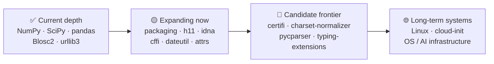
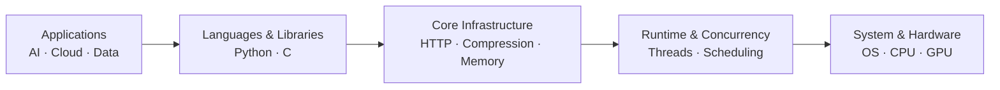
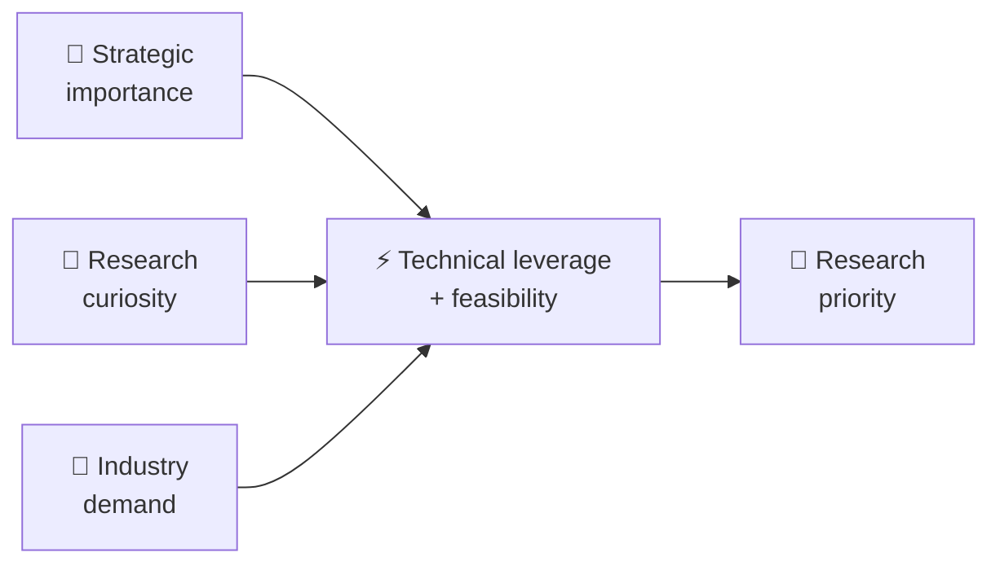
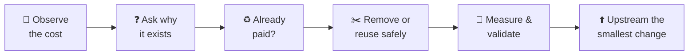

# CoreFoundry — Research Archive

Detailed research history, measured results, attribution, and engineering methodology.

Measured performance results and attribution

## 🚀 Selected high-impact upstream work

| Project / PR | What it is | What changed | Measured impact | Why this matters |
|---|---|---|---:|---|
| **[LZ4 #1927](https://github.com/lz4/lz4/pull/1927)** | Foundational LZ4 frame-file compression | **Original code author: Johnny Kao.** The PR author submitted the exact one-line fix Johnny first published in [issue #1858](https://github.com/lz4/lz4/issues/1858); an upstream contributor submitted it and the maintainer merged it on 2026-10-26. Skips zero-length `fwrite()` calls in `LZ4F_write()` | **~10–25% faster** for tested 1- and 16-byte buffered writes (`autoFlush=0`) across x86-64 GCC/Clang and ARM64 GCC; x86-64 GCC 1-byte example: **11.1 → 8.7 ns/call** (Johnny's original tests) | Removes an avoidable call without changing compressed output in the tested cases; larger writes and `autoFlush=1` showed mixed results |
| **[idna #279](https://github.com/kjd/idna/pull/279)** → **[maintainer #287](https://github.com/kjd/idna/pull/287)** | Python IDNA domain-label validation | Proposed an early return for ordinary non-ACE ASCII labels; the maintainer later merged an independent, simpler `check_label()` fast path in #287, explicitly referencing #279 and #286. Original #279 was closed unmerged. | **#279 candidate only:** 79.5–85.1% lower execution time in two tested ASCII `encode()` cases; not a benchmark of #287 | Demonstrates that validated performance ideas can be incorporated upstream in a different, more maintainable implementation |
| **[urllib3 #5304](https://github.com/urllib3/urllib3/pull/5304)** | Core HTTP gzip decompression | Eliminated unnecessary output copying on single-output paths | **~19–23% lower client CPU time** for tested 32 MiB gzip HTTP responses (8 paired A/B rounds) | Small, API-preserving changes can reduce CPU cost in foundational HTTP handling; controlled workloads, not a production-wide average |
| **[urllib3 #5287](https://github.com/urllib3/urllib3/pull/5287)** | Core HTTP infrastructure used throughout Python | Optimized the common single-value header path | **~9–13%** faster in representative request-construction workloads | Foundational HTTP improvements can propagate across a large number of Python applications |
| **[Memray #1035](https://github.com/bloomberg/memray/pull/1035)** | Python memory profiling and allocation-analysis infrastructure | Reduced high-contention synchronization overhead on Linux/glibc | **Up to 28%** runtime reduction at 256 threads | Profiling should observe workloads without becoming a major bottleneck itself |
| **[c-blosc2 #805](https://github.com/Blosc/c-blosc2/pull/805)** | High-performance compression infrastructure | Avoided unnecessary parallel startup and worker wakeups for small jobs | **35.86 μs → 2.02 μs** on a targeted 64-byte workload | Small workloads should not pay parallel execution costs they cannot amortize |
| **[python-blosc2 #728](https://github.com/Blosc/python-blosc2/pull/728)** | Python interface to high-performance compressed-data infrastructure | Removed redundant full-block zeroing in a NumPy miniexpr gather path | **~2–15%** improvement in tested workloads | Avoiding unnecessary memory work improves throughput without adding compute |

**LZ4 attribution and evidence:** Johnny Kao authored and publicly supplied the exact merged code in [lz4 issue #1858](https://github.com/lz4/lz4/issues/1858), with his original cross-platform benchmark measurements. Another contributor submitted that code unchanged as [PR #1927](https://github.com/lz4/lz4/pull/1927), which was merged upstream. The [public attribution note](https://github.com/lz4/lz4/pull/1927#issuecomment-6406029416) records this provenance. Johnny is **not** claimed as the PR submitter or a Git commit co-author. The measurements above are from Johnny's original tests, not a universal production speedup. No temporary research repository or CI-run links are needed to preserve this record.

**idna attribution and evidence:** Johnny Kao proposed and tested the ASCII LDH fast-path idea in [idna #279](https://github.com/kjd/idna/pull/279), including differential, boundary-case, and performance validation. The maintainer's [PR #287](https://github.com/kjd/idna/pull/287) explicitly says it addresses the optimization sought in **#279 and #286**, and was [merged on 2026-10-29](https://github.com/kjd/idna/commit/605884450001cb08c71ab04433c2581f25ca347c). **#287 is the maintainer's separate implementation, not Johnny's code; #279 was closed without merge.** The 79.5–85.1% measurements above are from the #279 candidate on its stated benchmarks, not measured speedups of the merged #287.

Security vulnerability reports

## 🔐 Security vulnerability discoveries

**[CERN ROOT #23940 — RNTuple mini-file anchor decompression](../SECURITY_RESEARCH.md#cern-root-23940--rntuple-mini-file-anchor-decompression)** — **Discovered and reported by Johnny Kao.** ROOT maintainer Jakob acknowledged the private security report and submitted [upstream fix PR #23940](https://github.com/root-project/root/pull/23940) on 2026-11-02, explicitly stating **“Issue reported by Johnny Kao.”** The fix addresses invalid anchor size/length combinations and uses the on-disk size for the input buffer. This is **reporter credit, not PR authorship**; merge status and severity are not claimed.

**[CVE-2026-115529 — curl Schannel TLS session resumption](../SECURITY_RESEARCH.md)** — **Originally discovered and reported by Johnny Kao** on 2026-10-22. Johnny provided reproducible Schannel/TLS test evidence and identified the 8.12.0 regression. curl accepted the report, assigned a CVE, and committed a fix with explicit `Reported-by: Johnny Kao` credit. Severity: Low (upstream assessment). The HackerOne report was fully disclosed on 2026-10-26; formal advisory and curl 8.24.0 remain scheduled for 2026-12-09. [Original report](https://hackerone.com/reports/4136767) · [Upstream fix](https://github.com/curl/curl/commit/12ab9f50d7c358b44188fe972cc15ba068901de9) · [Advisory draft](https://github.com/curl/curl-www/pull/665).

---

Other selected upstream work

## 🧩 Other selected upstream work

| Project / PR | What it is | What changed | Measured / practical impact | Why this matters |
|---|---|---|---:|---|
| **[QuickFIX/J #1363](https://github.com/quickfix-j/quickfixj/pull/1363)** | FIX financial-messaging transport | Corrected synchronous `IoSessionResponder.send()` to distinguish a completed MINA `WriteFuture` from a successfully written one | **Merged correctness fix**; regression coverage and **9/9 fork CI jobs passed** (Java 8/11/21 × Linux/Windows/macOS) | Prevents completed-but-failed synchronous writes from being reported as successful, without changing asynchronous or timeout behavior |
| **[NumPy #32802](https://github.com/numpy/numpy/pull/32802)** | Foundational numerical-computing library | Fixed undefined shift behavior | **Correctness fix** | Low-level correctness bugs can affect a very large downstream dependency graph |
| **[SciPy #26225](https://github.com/scipy/scipy/pull/26225)** | Scientific-computing algorithms and numerical methods | Improved bracketing-solver iteration statistics | **More accurate solver accounting** | Better internal accounting improves reliability and makes behavior easier to reason about |
| **[python-blosc2 #713](https://github.com/Blosc/python-blosc2/pull/713)** | Compressed-array and data infrastructure | Improved free-threaded Python correctness | **Concurrency readiness** | Infrastructure must remain correct as Python moves toward broader free-threaded execution |

Research map and infrastructure context

## 🗺️ CoreFoundry project map

CoreFoundry is not a collection of unrelated PRs. The work follows a deliberate path from scientific/data infrastructure toward more general Python infrastructure, protocol/native boundaries, and eventually system-level infrastructure.

### Project groups

| Group | Projects | Role |
|---|---|---|
| **Scientific & data infrastructure** | NumPy, SciPy, pandas, python-blosc2, c-blosc2 | Numerical computing, arrays, compression, data movement |
| **General Python infrastructure** | urllib3, packaging, python-dateutil, attrs | Widely reused runtime and packaging foundations |
| **Protocol / trust / native boundaries** | h11, idna, certifi, cffi | HTTP, naming, TLS trust, Python↔C boundary |
| **Candidate infrastructure frontier** | charset-normalizer, pycparser, typing-extensions, six | Broader foundational dependency surface |
| **Long-term systems direction** | Linux distribution, cloud-init, OS/runtime infrastructure | Deeper system layers and AI-era infrastructure |

> Status matters: projects in the final two rows are **directional targets or candidates**, not claims of existing contribution.

---

## 🧱 Where the work sits

The common thread is leverage: work lower in the stack can propagate upward into many downstream workloads.

That is why CoreFoundry deliberately prioritizes foundational infrastructure instead of isolated application-level optimization.

---

Organization-linked work

## 🏢 Organization-linked open-source work

Some projects are maintained by companies or foundations. These are grouped separately so infrastructure teams can quickly find work relevant to their ecosystem.

### Bloomberg-maintained open source

| Project / PR | What it is | What changed | Impact |
|---|---|---|---:|
| **[Memray #1035](https://github.com/bloomberg/memray/pull/1035)** | Python memory profiling infrastructure | Reduced contention overhead | **Up to 28%** at 256 threads |

> Listing an organization or project here refers only to public open-source work. It does not imply sponsorship, endorsement, or representation of CoreFoundry.

---

Research principles and methodology

## 🎯 How I choose what to work on

I prioritize opportunities where several factors overlap:

- broad infrastructure reach;
- a measurable recurring cost;
- strong technical leverage;
- realistic upstream acceptance;
- clear correctness boundaries;
- real-world demand or a compelling research question.

---

## 🧠 Research philosophy

> **Before optimizing a cost, ask why the system is paying it at all.**

The principle is **zero-incremental-resource optimization**:

> Extract more useful work from the resources already being used before asking for additional ones.

In practice, that means reducing unnecessary CPU, memory, synchronization, data movement, initialization, or control-path work while preserving correctness and maintainability.

---

---

